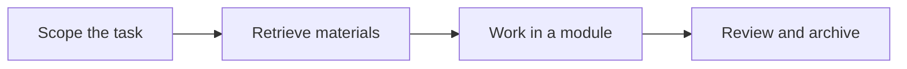

# Deep Loom

A local workspace framework for academic tasks, from scoping and evidence retrieval to delivery and archiving.

[中文](README.md) · [HTML version](README_EN.html)

## How a task moves through the workspace

An operator selects the lead module and confirms handoffs. Workspace data is created locally. The module graph describes workflow and read/write boundaries.

## Quick start

1. **Set up a local workspace**
   Copy the blank project and query templates and fill in the task goal, permitted materials, and delivery location.  
   [Project template](core/schema/project.yaml) · [Query card](core/schema/query.yaml) · [Blank configuration](templates/config.yaml)
2. **Choose a lead module**
   Use the routing guide to choose a skill. Verify source details and keep working files in the local project folder.  
   [Task routing](core/router.md) · [Retrieval guide](core/retrieve.md)
3. **Review and archive**
   Confirm which materials were used, the deliverable version, and the relationships to record. Run core scripts locally when you need usage logging or text extraction.  
   [Archiving guide](core/archive.md) · [Core commands and dependencies](core/README.md)

## Seven academic workflows

- **Research ideation** · Narrow a research question and check competing explanations, data access, and inference conditions. [SKILL.md](modules/research-ideation/SKILL.md)
- **Literature search and review** · Log searches and screening, verify bibliographic details, and build an evidence matrix and review. [SKILL.md](modules/paper-writing/SKILL.md)
- **Close reading** · Take notes on a paper’s structure, methods, evidence, and limitations. [SKILL.md](modules/paper-reading/SKILL.md)
- **Textbook chapters** · Organize learning objectives, chapter structure, explanations, and citations. [SKILL.md](modules/textbook/SKILL.md)
- **Chinese grant applications** · Use the call guidelines to choose a direction, build the argument, and plan the work. [SKILL.md](modules/grant-writing/SKILL.md)
- **Teaching cases** · Write the case and teaching note, with traceable support for factual claims. [SKILL.md](modules/case-writing/SKILL.md)
- **Citation and text audit** · Check citations, factual claims, and sources, then document revisions. [SKILL.md](modules/citation-audit/SKILL.md)

## Layout and runtime

- `core/` · Workflow guides, module graph, field templates, and Python tools
- `modules/` · Seven skills and their module declarations
- `templates/` · Blank configuration for the deployment

Four core Python tools extract text, calculate project time, append usage records, and report usage. Use Python 3.10 or later. DOCX extraction uses the standard library. PDF and legacy DOC extraction require a local converter.

Operators handle retrieval, archiving, and handoffs. Close reading, chapters, grant applications, cases, and citation audit are manual workflow guides. The original generators and dashboard, automated retrieval and archiving, and project workbook sync are outside this distribution.

A repository-wide license has yet to be determined.

[Core architecture](core/README.md) · [Module graph](core/module-graph.md) · [Blank field templates](core/schema/README.md)
